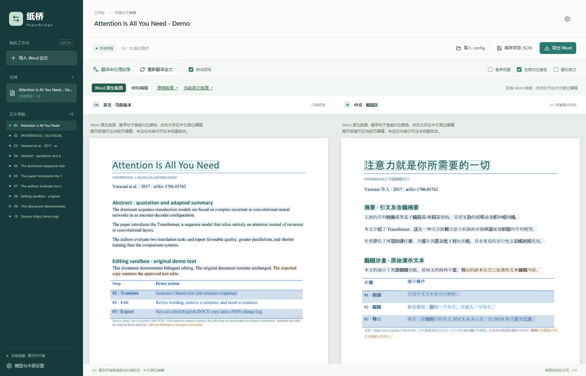
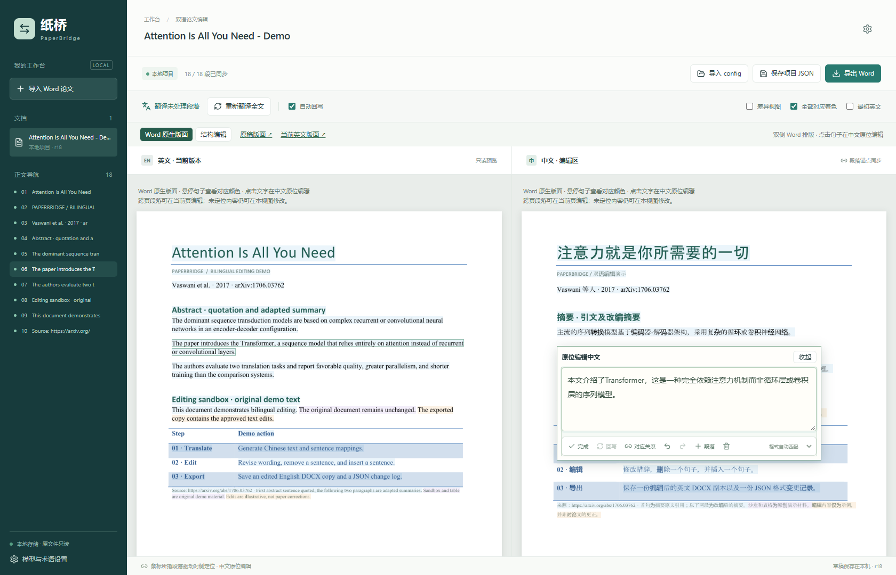
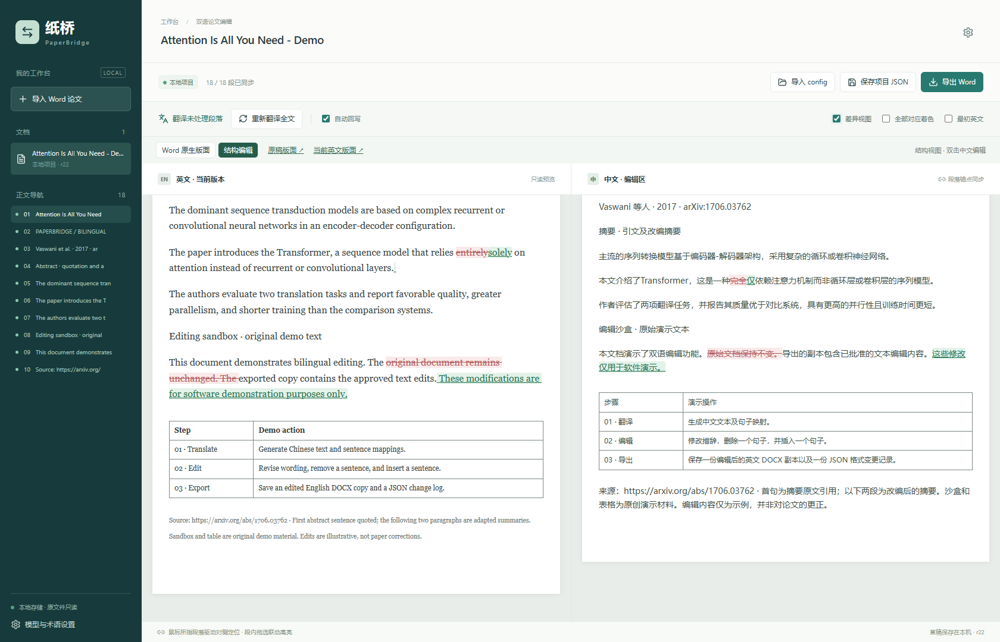
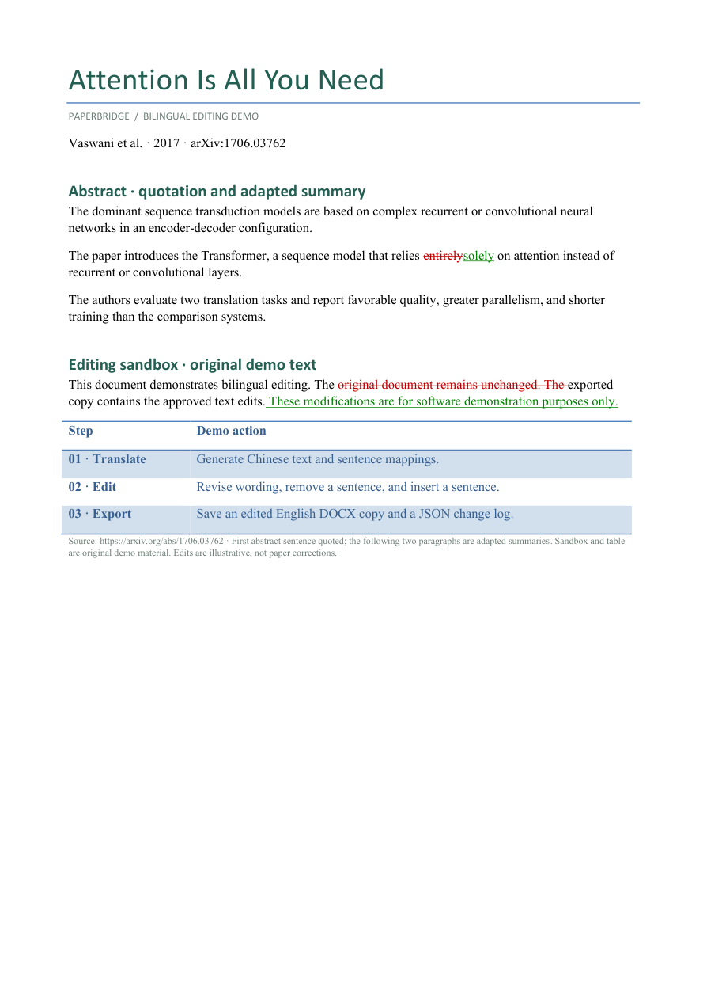

<div align="center">

# 纸桥 · PaperBridge

### 改中文，同步改英文论文。

**Bilingual paper editing with aligned translation, focused rewrites, and DOCX export.**

[](https://github.com/jkjkiiiii/PaperBridge/actions/workflows/ci.yml)


[](LICENSE)


[演示](#演示从论文阅读到修改回写) · [快速开始](#快速开始) · [模型接入](#模型接入) · [使用指南](docs/user-guide.md) · [参与开发](CONTRIBUTING.md)

</div>

PaperBridge 是一个本地运行的论文双语编辑工具。导入英文 `.docx`，左右对照阅读，在中文侧修改内容，让模型只回写受影响的英文句子。修改记录为可重放的 JSON，最终另存为保留原文档结构和样式的英文 Word 副本。

## 演示：从论文阅读到修改回写

示例取自 Vaswani et al. 的 [*Attention Is All You Need*](https://arxiv.org/abs/1706.03762)。使用一条有出处的短引文、摘要改编和原创编辑练习制作独立 DOCX，展示真实界面中的翻译、对应关系和编辑差异。**这不是论文官方 Word 文件；演示改写用于展示软件，不是对原论文的科学修订。** 来源及复现说明见 [Demo 说明](examples/attention/README.md)。

### 01 · 保留文档阅读体验

Word 原生版面由本机 Microsoft Word 排版，保留页面中的表格、图片、公式与文字位置。中英文长度不同，可以自然产生不同分页。



### 02 · 在中文侧编辑

点击可定位的文字，在段落位置打开编辑框。句子对应色帮助确认修改范围；模型完成回写后，收起编辑框即可查看更新后的排版。



### 03 · 检查英文变化

结构编辑与 Word 原生版面均支持差异视图：红色删除线标出删去的文字，绿色下划线标出新增文字。英文优先整词对比，常见时态变化才细化到词内。未受影响的英文保持原样。

Word 差异预览使用临时副本，同时显示新旧文字可能引起重新分页；变更段按段定位，未变段保留逐句对应。关闭差异视图后恢复当前文稿版面，正常 DOCX 导出仍是干净副本。



**Word 原生版面中的差异预览：**



## 全论文实测：翻译与句子映射

2026 年 11 月 4 日，我们用 [*Attention Is All You Need*](https://arxiv.org/abs/1706.03762) 的可编辑 Word 重建稿，运行了一次火山文本翻译初译 + DeepSeek Flash 句子映射。DeepSeek 控制台显示本次费用约 **¥0.12**。

| 本次样本 | 实测结果 |
| --- | --- |
| 火山初译 | 178 次请求，27,490 字符 |
| DeepSeek 句子映射 | 178 次请求，98,982 tokens（输入 91,124，输出 7,858） |
| 参考文献 | 40 条及标题跳过翻译和映射，调用 0 次 |
| 用时 | 顺序请求约 5 分 51 秒 |

首次运行的两处映射降级已定位并单独复测：一段恢复为 5 组 `1:1`，另一段保留合理的 `2:1` 合句对应，中英文文字不变；复测新增约 ¥0.0029，单独计量。

这是一次测量，并非所有论文的费用、速度或翻译质量保证。火山费用取决于账号剩余免费额度；本次未核实剩余额度。机器直译存在专业术语错误，正式使用前需要人工审校。Word 是依据论文源码制作的可编辑重建稿，不是官方 Word，也不保证与原 PDF 像素一致。范围、映射降级和计费细节见 [完整实测说明](docs/attention-cost-case.md)。

## 能做什么

| 能力 | 使用方式 |
| --- | --- |
| **双语对照** | 按段落定位，支持增强对比的句子对应色、悬停轮廓和必要的多对多对应 |
| **鼠标指向对齐** | 指向任一侧的段落，只移动对侧到相同阅读位置 |
| **局部英文回写** | 修改中文后，仅允许受影响的英文句子变化 |
| **两种阅读视图** | Word 原生页面支持阅读、原位编辑与 diff；结构视图支持细致编辑、表格与映射修复 |
| **完整变更记录** | 自动保存草稿、撤销／重做、JSON 导出与校验重放 |
| **DOCX 副本导出** | 在原始包上应用文字补丁，保留未修改内容与样式属性 |
| **全文重新翻译** | 换模型后创建独立重译版本，重建译文与映射，保留旧版本 |
| **多厂商接入** | 本地模型与云端 API，翻译、回写、对齐修复可分别选择模型 |

## 快速开始

当前主要验证环境：**Windows、Python 3.12、Node.js 22**。Word 原生版面另需安装 **Microsoft Word**；推理需要可用的本地模型服务或云端 API。

### Windows

下载仓库后，在项目根目录打开 PowerShell：

```powershell
.\setup.ps1
.\run.ps1 -OpenBrowser
```

安装脚本会创建独立的 `.venv`，安装锁定依赖并构建前端。启动后访问 **[http://127.0.0.1:17865](http://127.0.0.1:17865)**。

### 手动安装

```bash
python -m venv .venv
# Windows: .venv\Scripts\activate
# macOS / Linux: source .venv/bin/activate
python -m pip install -r requirements.txt
npm --prefix web ci
npm --prefix web run build
python -m uvicorn server.app:app --host 127.0.0.1 --port 17865
```

结构编辑不依赖 Word；Windows 以外系统的运行情况尚未完整验证。Word 原生渲染仅适用于安装了 Word 的 Windows 桌面环境。

### 第一次使用

1. 打开 **模型与术语设置**，选择厂商或本地服务，填写模型及凭据。
2. 点击 **保存并测试所选模型**，确认短句翻译与结构化输出可用。
3. 导入 `.docx`，点击 **翻译未处理段落**。
4. 在中文侧修改，查看英文回写和 **差异视图**。
5. 确认待处理内容后，导出 **英文 Word + 项目 JSON**。

详细设置、异常处理与恢复说明见 [使用指南](docs/user-guide.md)。

## 模型接入

| 厂商 / 服务 | 接口与配置 |
| --- | --- |
| **Kimi 开放平台** | 中国站／国际站分别配置，OpenAI-compatible Chat Completions |
| **OpenAI** | 默认 Responses，也支持 Chat Completions |
| **Anthropic** | 原生 Messages，结构化工具结果 |
| **Google Gemini** | 原生 `generateContent`，AI Studio API Key |
| **DeepSeek** | 官方 Chat Completions、JSON Object、账号模型发现 |
| **LM Studio / 自定义服务** | 自定义地址、协议与模型 ID |

模型下拉优先读取当前账号可用列表，也允许填写自定义 ID。各厂商密钥独立保存，切换标签不会把本地模型密钥带到云端。

更换模型只影响后续任务，**不会自动覆盖已有译文**。要重做全文，使用 **重新翻译全文**。Kimi Code 会员与开放平台是独立服务；后台批量重译使用开放平台。接入依据见 [厂商适配说明](docs/provider-adaptation.md)。

## 独立翻译 API

初始翻译可单独选择 **火山引擎、DeepL、Azure Translator、自托管 LibreTranslate**，也可继续用通用 LLM。专用 API 生成中文，通用 LLM 负责句子映射和英文回写。服务额度、配置步骤与模块设计见 [翻译服务说明](docs/translation-services.md)。免费额度取决于账号方案，云端 LLM 的映射和回写可能另行计费。

## 数据与格式边界

- **文稿存储在本机**：原稿、译文、草稿及缓存位于 `.data/`；相关模型请求发送到你选择的服务，本地存储不代表云端推理离线。
- **原文件不改动**：导出生成新的英文 DOCX。密钥不返回浏览器，也不写入项目 JSON。
- **保留样式，允许重排**：文字长度改变可能引起换行和分页，不承诺编辑后页面像素不变。
- **页面定位有降级**：重复数字、图片或公式等保护对象和无法确认的文字不会猜测坐标；已识别的 Word 零宽书签不再阻断整段定位，可在原生视图的浮动编辑区或结构视图处理。
- **导出需要一致状态**：有待回写、冲突或失效映射时，阅读仍可继续，但完整 DOCX 导出会等待处理完成。
- **当前输出**：干净的英文 DOCX 与 JSON 变更记录。JSON diff 不是 Word 内置修订；尚不提供 Word Track Changes、完整 Word 编辑内核或中文／双语 DOCX 导出。

模型输出合法与语义正确是两回事。正式文稿仍需检查术语、数值、引用和修改后的含义。

## 宣传与演示素材

提供 [八图总览](docs/promotion/kit/gallery.html)、[宣传图与来源说明](docs/promotion/kit/README.md)和[小红书文案第二版](docs/promotion/kit/xiaohongshu-copy-v2.md)。图片包含 1080×1920 发布版和 2160×3840 高清版；原创功能示意、真实界面截图与单次费用实测分别注明来源和范围。

## 开发与项目结构

```text
server/             FastAPI、模型适配、映射状态与 DOCX 补丁
web/                React + TypeScript 双语编辑界面
tests/              文档、映射、协议与状态一致性测试
scripts/            开发、验证与演示工具
examples/attention/ 公开论文节选演示与出处
docs/               使用指南、架构和厂商接入说明
.data/              本地运行数据（不提交）
```

```powershell
.\.venv\Scripts\python.exe -m pytest -q
npm --prefix web run build
```

前端开发服务可使用 `npm --prefix web run dev`。贡献约定见 [CONTRIBUTING.md](CONTRIBUTING.md)。问题反馈请说明视图、操作步骤、模型协议及脱敏日志，不要上传密钥或未授权文稿。

## Acknowledgements

Demo 论文：Ashish Vaswani et al., *Attention Is All You Need*, 2017，见 [arXiv:1706.03762](https://arxiv.org/abs/1706.03762)。论文及演示中引用内容的权利归原作者／权利人所有。

厂商接入设计参考 OneClaw 的配置分层思路及各服务官方文档，相关依据记录于 [provider-adaptation.md](docs/provider-adaptation.md)。

## License

项目原创代码采用 [MIT License](LICENSE)。论文引文及第三方依赖遵循各自的权利声明，见 [NOTICE](NOTICE) 和 [第三方说明](THIRD_PARTY_NOTICES.md)。PyMuPDF 使用 AGPL-3.0／Artifex 商业双许可证，MIT 声明不替代该依赖在组合使用或分发时的要求。
