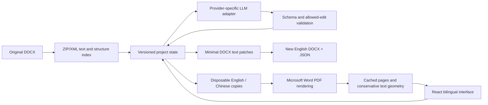

# Architecture

## Document source and edits

`server/documents.py` indexes paragraph/run text and document structure. Original package bytes are retained. Export applies bounded changes to a copy rather than rebuilding the document from HTML or PDF. Images, equations, fields and other protected content cannot be edited as plain text.

`server/state.py` owns stable IDs, committed bilingual text, Chinese drafts, mappings, history and final effective patches. A successful rewrite commits English and mapping changes together. Late responses cannot replace a newer editing revision.

## Model boundary

`server/llm.py` builds task-specific requests and validates structured results. `server/provider_catalog.py` describes provider defaults and authentication. Keys stay in the local secret file, outside public project exports. Full retranslation creates an independent version with a pinned model configuration.

## Views

The structure view renders paragraphs and complete tables. The native view uses Word-produced PDF pages plus position overlays. It does not implement Word's layout engine. Geometry is conservative: ambiguous text remains visible but receives no guessed sentence location. Unmatched paragraphs remain editable through a labelled floating editor.

PDFs, page PNGs, geometry and browser snapshots are cached. Dirty projects can still display committed content; export remains blocked until unresolved edits are handled.

## Validation boundaries

Normal tests cover deterministic document, state, API and protocol behavior. Native Word rendering is optional and local. A real-model demo verifies a selected workflow, not general translation accuracy. Cloud adapter tests use mocked responses unless explicit user credentials are configured.
