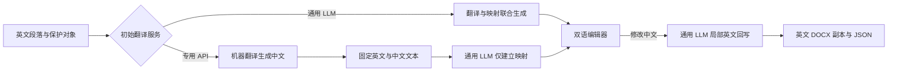

# 独立翻译服务与通用 LLM

## 配置与职责

设置页分为“翻译服务”和“通用模型”。初始翻译可以继续使用 LLM，也可以使用专用机器翻译服务；实际使用哪一项统一在“任务分配”中选择。两者使用独立的服务配置与凭据文件。已有译文不因设置变化而自动改写；选择新翻译服务后，用“重新翻译全文”创建新版本。

专用 API 默认以段落为上下文单位。保护标记留在本地，只将相邻普通文本发送给服务；超出服务字符限制时内部按句子／空白边界分块，文稿段落结构不变。结果落到句子单元，再将固定的中英文本交给“对齐修复／专用翻译映射”所选 LLM；该调用不允许改写译文。词汇表与学术风格设置仍供 LLM 使用，不代表已开通各机器翻译厂商的专属术语库。

若句级映射失败，保留机器译文，明确标记为整段粗粒度对应。局部回写需要修复映射或明确允许修改的范围；不假装得到1:1映射。翻译服务失败不会自动改用另一家服务。选用云端 LLM 做映射或回写可能产生独立费用，专用 API 免费额度不等于整个流程零费用。

## 首批接入与免费条件

以下说明按本次核对的官方资料整理，实际账户资格、额度及区域以服务控制台为准。

| 服务 | 接入方式 | 免费或低成本入口 |
| --- | --- | --- |
| 火山引擎机器翻译 | TranslateText，AK/SK HMAC 签名 | 官方文本翻译每月前200万字符免费，需开通服务；超额按量计费 |
| DeepL API | 官方REST及DeepL-Auth-Key | 旧API Free每月50万字符；新API Developer为100万字符总免费额度、不按月重置，端点随方案选择 |
| Azure Translator | 官方REST，资源Key及可选区域 | F0层每月200万字符；付费层不能直接视作同等免费套餐 |
| LibreTranslate | 自托管REST，可选API Key | 软件可自托管；服务器成本自理，公共托管实例不保证免费 |

DeepL旧Free通常用`https://api-free.deepl.com`，当前Developer／Pro按账号说明选`https://api.deepl.com`。火山默认地址固定为官方签名端点。Azure区域填写资源所属区域，不能拿其他产品的Key替用。

[沉浸式翻译的服务文档](https://immersivetranslate.com/docs/services/)是本次服务调研入口。浏览器插件中的免费网页翻译能力，不等于可在独立后端无限使用的官方免费API。本工具接入官方接口及可配置自托管实例，不依赖网页抓取或未公开的Google/Bing端点。

## 使用步骤

1. 打开“模型与术语设置 → 翻译服务”。
2. 添加服务并填写其专用凭据；保存后的值不返回浏览器，留空保持原值。
3. 点击“保存并测试所选服务”，只发送一条固定短句。
4. 打开“任务分配 → 初始翻译”，在专用 API 和通用 LLM 两组选项中选择。
5. 同一页面选择“句子映射与修复”“英文回写”的通用 LLM，并点击“保存任务分配”。
6. 翻译新文稿，或在旧文稿选择“重新翻译全文”。后台任务固定启动时的翻译及模型配置，暂停后继续不会悄悄切换服务。

## 模块与数据

- `server/translation_services.py`：专用API适配与服务目录。
- `server/translation_settings.py`：翻译设置及凭据边界。
- `server/translation_router.py`：翻译结果、句子映射及降级处理。
- `.data/translation-settings.json`：不含凭据的服务配置；旧选择会被自动迁移读取。
- `.data/task-assignments.json`：统一的初始翻译、映射与回写任务选择。
- `.data/translation-secrets.json`：本机凭据，整个`.data/`不提交。
- `.data/translation-cache/`：按文字、服务配置与映射模型区分的结果缓存。

项目JSON和重译快照不带翻译凭据。切换主机或服务类型时不会沿用该服务ID旧凭据。

## DeepSeek 通用模型

“通用模型”新增独立DeepSeek标签，默认官方`https://api.deepseek.com`、OpenAI兼容Chat Completions及JSON Object输出；按官方文档关闭思考，读取账号可用模型或填写自定义ID。模型候选只是文档示例，账号列表才是当前可用性依据。DeepSeek网页产品与API账单不同，不能把网页免费理解为API免费。

## 官方参考

- [火山文本翻译接口](https://docs.volcengine.com/docs/machine-translation/text-translation-api?lang=zh)
- [火山机器翻译计费](https://docs.volcengine.com/docs/MachineTranslation/Productbilling?lang=zh)
- [DeepL API方案](https://support.deepl.com/hc/en-us/articles/360021200939-DeepL-API-plans)
- [Azure Translator免费层说明](https://www.microsoft.com/en-us/translator/business/faq/)
- [LibreTranslate API](https://docs.libretranslate.com/api/)
- [DeepSeek接口](https://api-docs.deepseek.com/)与[JSON输出](https://api-docs.deepseek.com/guides/json_mode)

## 验证范围

适配器签名／请求模拟、配置凭据隔离、映射降级和全文重译回归测试均有独立覆盖。火山已用实际账户完成固定短句和两段样例翻译，并与本机Qwen完成句子映射、局部回写、Word导出及全文重译联调。其余翻译服务与DeepSeek没有提供真实账户凭据，已做协议模拟及界面验证，不能据此声称云账户已实测连通。

## 请求控制：限速、文本大小和条目数

在“翻译服务 → 请求参数”可分别配置：

| 参数 | 默认 | 含义 |
| --- | --- | --- |
| 每秒最大请求数 | 5 | 同一服务共享滚动1秒发送限制，超出后异步排队 |
| 每次最大文本长度 | 1800字符 | 一次请求所有文本项的合计字符数 |
| 每次最大段落数 | 8个文本项 | 请求数组的最大条目数，包含保护对象分隔／长段落内部切片 |

8条文本不是8个并行请求。当前全文处理仍逐段进行，通常不会把8个Word段落并发提交；这些参数只是批次上限，不会为了凑满数量延迟当前段。服务硬上限另行校验，例如火山单次5000字符、16条以内；这些上限不是账号的实际QPS配额。后端进程内多个调用共享限速队列；部署多个进程时需要外部统一限流。所有参数随新重译任务固定，不进入凭据文件。

任务选择与服务连接相互独立：保存服务地址／密钥不会改变已保存的任务分配。删除当前任务正在使用的模型或服务会被阻止，需先在任务分配中切换。
